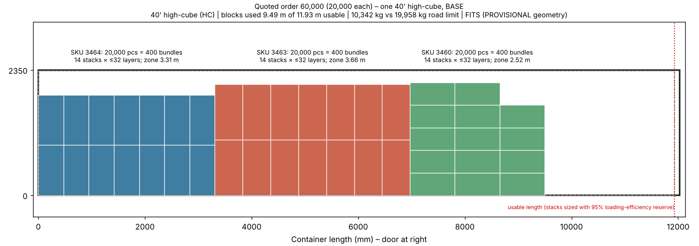
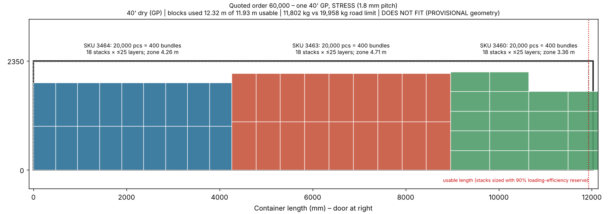
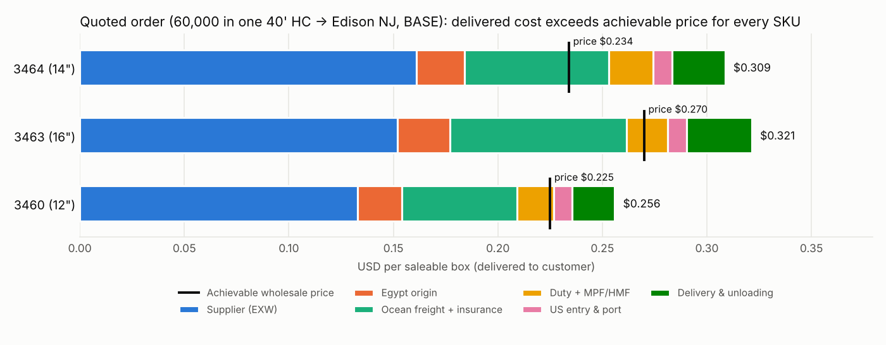
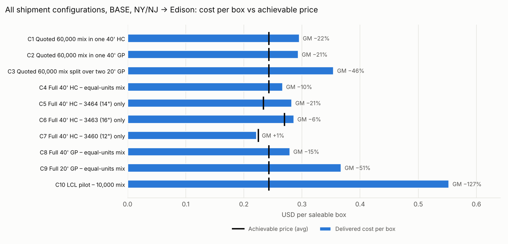
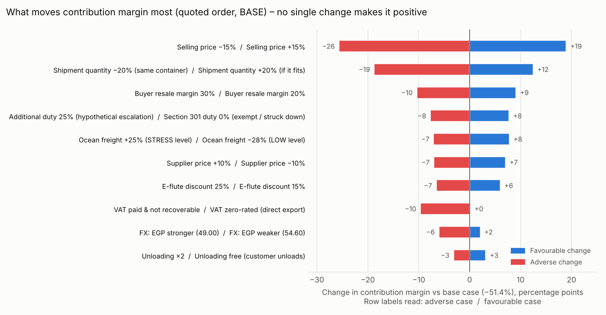
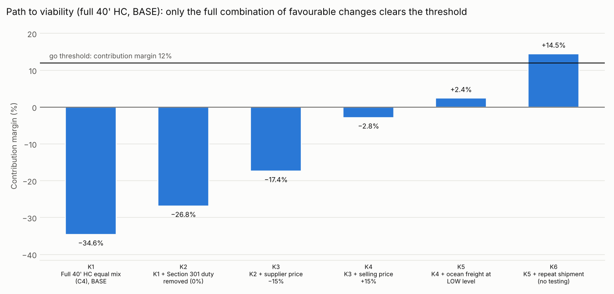

# BigBoxPizza — Egypt → US East Coast pizza-box import
## Market validation, landed-cost model and commercial decision report

| Item | Detail |
|:---|:---|
| Client | BigBoxPizza (Egyptian-origin pizza-box export business) |
| Supplier quotation | Nile Factory Carton (NFC), offer NFC-OFFER-2026-0120 dated 23-Sep-2026, valid until 30-Sep-2026 (expired) [S001] |
| Valuation date | 16-Oct-2026 (research started 2026-10-15 23:47 UTC) |
| Deliverables | This report; `BigBoxPizza_US_Landed_Cost_Model.xlsx`; `BigBoxPizza_Source_Register.csv`; `BigBoxPizza_Assumptions_and_Gaps.md`; `BigBoxPizza_RFQ_Pack.md`; `BigBoxPizza_Calculation_Audit.md`; `scripts/` |
| Original quotation (preserved) | `BigBoxPizza/evidence/NFC-OFFER-2026-0120_original.pdf` (SHA-256 ecfdf33b…f91b0); transcription `evidence/NFC-OFFER-2026-0120_transcription.md` |
| Model status | Validated: recalculated in LibreOffice; 189 engine cases match an independent Python engine; 0 formula errors |

> **Evidence notice.** No written freight, broker, trucking, supplier re-quote or buyer quotations were available, so every logistics and market figure is an **estimate built from documented sources**, not a quoted or paid amount. In this research environment the network policy blocked direct access to all 70 source websites (check of 2026-10-16) and to hts.usitc.gov, api.census.gov and NFC's domain nilecarton.com (tested 2026-10-15); sources were read through search-engine extracts and are recorded as such in the source register. Re-verify every VERIFIED_OFFICIAL item on the live site before any shipment. This report is not legal or tax advice.

## 1. Executive verdict

**Verdict: NO-GO under the modeled conditions.** Do not pay the 50% advance and do not place the quoted 60,000-box order.

Why:

1. **Delivered cost is above what a US wholesale buyer can pay.** In the BASE case, the quoted order (one 40' high-cube to a customer in Edison, NJ) costs **$0.295 per saleable box delivered**. The evidence-based achievable wholesale price is **$0.243**. That is a gross margin of **−21.5%** and a contribution of **−$7,383** (−51.4%) on a cash outlay of $21,183.
2. **No shipment configuration fixes it.** The best BASE option, a full 40' high-cube of 12" boxes only, reaches a gross margin of +1.3% and a contribution margin of −19.7%. Every configuration fails even lenient thresholds (gross margin ≥5%, contribution ≥0). Only the LOW scenario, where every uncertain input turns favourable at once, passes.
3. **The gap is structural, not a rounding issue.** The NFC price alone is 61.1% of the achievable revenue. Ocean freight ($0.068/box), the 12.5% Section 301 duty on Egyptian goods ($0.019/box) and delivery to the customer use up the rest. NFC would have to cut its price by 31% just to break even at gross-profit level, and by 68% to reach a 25% gross margin on the quoted mix. Alternatively, selling prices would need to be 55% higher than the benchmark.
4. **Several facts that are prerequisites for any shipment are missing.** The quote has expired and states no Incoterm. NFC's identity and bank beneficiary could not be verified (no independent public record was found [S088]). The board specification and food-contact/PFAS documentation are absent. "SINGLE-E" 14" and 16" boxes are lighter than the US B-flute norm for those sizes [S073][S082], and it is unclear whether the quoted dimensions are inside or outside measurements.

**The client's plan: a full 40' high-cube of all three sizes (configuration C4).** The client intends to fill the container rather than ship the quoted 60,000 boxes. The largest equal mix that fits is 25,800 of each size (77,400 boxes, 13.3 t) in the BASE case, 64,200 if bundles are thicker (STRESS) and 84,000 if thinner (LOW). Delivered cost falls to $0.267/box while the buyer price stays $0.243: gross margin −9.7%, contribution −$6,406 (−34.6%) on the first shipment and −$3,839 on a repeat, with peak cash of $24,413. Breaking even needs buyer prices 37% higher, or a factory price 14% lower to cover the delivered cost. At the average US case prices of [S102] it about breaks even on the first shipment (−$163) and makes $2,404 (9.6%) on a repeat, short of the 12% minimum. Changing the size mix moves the middle-case result by under $300 (`working/04_full_container_plan.md`). The verdict does not change.

**What would have to change before re-opening the file (re-entry conditions; all are needed together, see §18–19):**
- Written buyer offers for container lots that clear the break-even prices in §13: about **$0.376/box** for the quoted mix, or about **$0.272/box** for full containers of 12" boxes.
- A dated NFC re-quote on FCA terms, zero-rated for VAT, at or below the maximum prices in §16. For a full 40' HC of 12" boxes and a 25% gross margin that maximum is **EGP 4.46/box**, against EGP 6.90 quoted.
- Broker confirmation of the duty position. Removing the 12.5% duty alone is not enough (§13).
- Verified supplier identity, specifications and compliance documents.

**Recommended next step:** stop the transaction. If BigBoxPizza wants to keep the option open, run a low-cost "paper pilot" (§17) costing about the model's sample, courier and lab-testing budget ($2,500; range $1,000–$4,000, ESTIMATED). It covers samples to US buyers, written buyer prices, an FCA re-quote and forwarder/broker quotes. Re-run this model with those quotes before any money is committed to a shipment.

## 2. One-page decision summary

| Question | Answer |
|:---|:---|
| 1. Is the NFC quotation still valid? | No. It expired on 30-Sep-2026. Reconfirm the price, validity, Incoterm (FCA preferred), the buying entity, VAT treatment, payment milestones and inclusions in writing (RFQ 1). |
| 2. Are the quoted prices competitive? | Not for the US. At $0.146/box ex-works (CBE rate), NFC's price alone already absorbs 61% of the achievable US wholesale revenue. 3464 (355 mm) is priced above the larger 3463 (405 mm), which is an anomaly. |
| 3. Are the specifications sufficient? | No. 'SINGLE-E' does not establish flute, grammage, recycled content, coatings, strength or food-contact compliance. Inside versus outside dimensions are unknown. |
| 4. How many boxes fit per container? | Provisional (BASE): an equal mix of the three sizes tops out at about 77,400 boxes per 40' HC (25,800 of each size), 67,800 per 40' GP (22,600 each) and 31,800 per 20' (10,600 each). Single SKU per 40' HC: 14" 76,000, 16" 66,850, 12" 106,400. Volume always binds, never weight. |
| 5. Can the quoted 60,000 mix ship economically? | It fits one 40' HC in every scenario (a 40' GP fails under STRESS bundle thickness), but at −21.5% gross margin it is not economic. |
| 6. Delivered cost per box by SKU (BASE)? | 3464 $0.3087; 3463 $0.3215; 3460 $0.2559; average $0.2953 (quoted order, NY/NJ → Edison). |
| 7. Total cash needed? | $21,183 in total; peak working capital $21,183; $7,504 before shipment. Recoverable VAT is shown as cash, not cost. |
| 8. Tariff treatment supported by evidence? | HTS 4819.10.00 at Free MFN, plus Section 301 forced-labor duty of 12.5% on products of Egypt (9903.05.36) from 24-Jul-2026 unless an Annex II exemption applies [S014–S018]. IEEPA tariffs were struck down and the Section 122 surcharge has expired. |
| 9. Best gateway (risk-adjusted)? | New York/New Jersey → Edison, NJ: $0.2953/box, with direct Egypt–NY services. Baltimore → Jessup is $0.2947, slightly cheaper, but rests on an assumed port differential and fewer Med services. |
| 10. Price needed for target margins? | 25% GM on the quoted mix needs an average of $0.394/box, against the $0.243 benchmark (see §13). |
| 11. What do comparable US products sell for? | Online restaurant-supply price for 12" E-flute is about $0.30–0.32. For 14"/16" B-flute it is $0.38–0.46, and $0.47–0.48 at club stores. These are asking prices, not transaction prices; reliability is medium. |
| 12. Can BigBoxPizza compete? | Not at NFC's quoted prices. Cleared at the port, the quoted order costs about $0.70/lb, against $0.74/lb for imports that the US industry alleges are dumped by 97–569% [S098][S099]. |
| 13. Expected contribution per shipment? | BASE, quoted order: −$7,383 on a first shipment and −$4,816 on a repeat shipment. LOW: $1,848. STRESS: −$21,183. |
| 14. What could reverse the decision? | Only a combination of four things: much higher written buyer prices, a far lower NFC price, no Section 301 duty and low freight (§13 path to viability). |
| 15. What to negotiate with NFC? | FCA terms with a zero-rated USD invoice, price cuts toward the maxima in §16, single-size full loads, specs and documents, 30/70 or LC payment, and validity. |
| 16. What must the forwarder and broker confirm? | Itemised door rates per gateway, free time and inclusions; HTS, Section 301 applicability, valuation, marking, bond and IOR set-up. |
| 17. Buyer evidence needed first? | Written prices or LOIs from at least 3 buyers for specified boxes, covering at least 70% of a container at or above break-even, after sample approval. |
| 18. Next step? | NO-GO now. Optional paper pilot, then re-run the model with real quotes. |

## 3. Quotation assessment

**What the document actually says** (verbatim transcription in `evidence/NFC-OFFER-2026-0120_transcription.md`):

| Code | Description (printed, Arabic) | Brief's transcription | Spec | L×W×H mm | Qty | EGP/box | Line EGP | USD/box* |
|---|---|---|---|---|---|---|---|---|
| 3464 | علبة بيتزا 5*35.5*35.5 | 5 × 5 × 5.5 inch pizza box | SINGLE-E | 355×355×50 | 20,000 | 8.365 | 167,300 | $0.1585 |
| 3463 | علبة بيتزا 5*40.5*40.5 | 5 × 40.5 × 40.5 cm pizza box | SINGLE-E | 405×405×50 | 20,000 | 7.900 | 158,000 | $0.1497 |
| 3460 | بيتزا 5*30.5*30.5 | 5 × 30.5 × 30.5 cm pizza box | SINGLE-E | 305×305×50 | 20,000 | 6.900 | 138,000 | $0.1307 |

\*At the effective rate of 52.7748 EGP/USD (CBE buy rate 53.04 on 15-Oct-2026 [S063], less a 0.5% bank spread).

- Totals reconcile: subtotal EGP 463,300; 14% tax EGP 64,862; total EGP 528,162; 60,000 pcs. The arithmetic checks are automated in the workbook.
- **The brief's description of SKU 3464 ("5 × 5 × 5.5 inch") does not match the document.** The document prints "علبة بيتزا 5\*35.5\*35.5" (pizza box 5×35.5×35.5), which is consistent with 355×355×50 mm. No description states a unit, and SKU 3460 lacks the word for "box". These points are flagged, not corrected.
- **No Incoterm is printed**, and "Shipping" is a dash. EXW is only the brief's working assumption.
- **Addressee:** the offer is made to a domestic buyer, "ا/ انيس شركة توريدات" (Alexandria, client code C330, tax ID blank), with 14% Egyptian VAT added. A direct export sale by a registered exporter would normally be zero-rated [S060][S062].
- **Validity:** expired 16 days before the valuation date. The prices are historical reference values (BASE re-quote change 0%; LOW −5%; STRESS +10%).
- **Payment:** "advance_50" is read provisionally as a 50% advance. The bank block prints "FAP MISR BANK" with SWIFT NBADEGCAXXX (the NBAD prefix historically belongs to First Abu Dhabi Bank, so the name may be a typo for "FAB Misr"). The IBAN passes the mod-97 check, which validates the format only. The signature reads "Abdelrahman Darwish" while the printed name is "Mahmoud Bakr". **Verify the beneficiary independently before any transfer.**

Price sanity check. Plan area is a preliminary measure only; board area uses the provisional blank estimate in §5.

| SKU | Nominal | Plan area m² | EGP per m² plan | Est. board m² | EGP per m² board | EGP per 1,000 |
|---|---|---|---|---|---|---|
| 3464 | 14" | 0.1260 | 66.38 | 0.4026 | 20.78 | 8,365 |
| 3463 | 16" | 0.1640 | 48.16 | 0.4932 | 16.02 | 7,900 |
| 3460 | 12" | 0.0930 | 74.17 | 0.3211 | 21.49 | 6,900 |

The 16" box (3463) is the cheapest per m² of board (≈EGP 16.0, against 20.8–21.5 for the others), and the 14" box costs more per unit than the 16". This needs an explanation (different board or print, a mis-key, or loss-leading) before the quote can be relied on. The weighted average is EGP 7.72/box, or $0.1463. The 18-item clarification checklist is in the workbook (Supplier Quotation §5); RFQ 1 covers every item.

**Tax views modelled (no double counting):**
| Mode | Treatment | Cash effect | Economic cost | When it applies |
|:---|:---|:---|:---|:---|
| 1 | Zero-rated direct export | No VAT | Nil | NFC (a registered exporter) invoices the foreign buyer and exports [S060][S062] |
| 2 (BASE) | VAT paid, refunded | $1,229 out, refund about 60 days after export | Financing cost only | An Egyptian trading company buys domestically and exports. Statutory 45-day refund [S060]; ETA target 20 days [S061] |
| 3 (STRESS) | VAT paid, not recovered | Out, no refund | +$0.0208/box; also enters customs value | Buyer is not a registered exporter or cannot claim |

## 4. Product specification assessment

- **"SINGLE-E"** most plausibly means single-wall E-flute corrugated board: about 1/16" (1.2–1.8 mm) thick with 90–100 flutes per foot. US 14"–18" pizza boxes are normally **B-flute** (about 1/8", 47–53 flutes per foot), which is stiffer and insulates better [S082][S073]. E-flute is mainstream for 10"–12" (for example the WebstaurantStore E-flute 12" [S074]) and niche for 14"/16" (Arvco E-flute via Imperial Dade [S079]).
- **Fit:** 305/355/405 mm = 12.0/13.98/15.94 in. US boxes are specified by inside size. If NFC's figures are outside dimensions, the 16" box may not accept a 16" pizza.
- **Food-contact suitability is unproven.** Pizza is a fatty food, so the food-contact surface must consist of substances permitted under 21 CFR 176.170 [S030]. Recycled fibre must meet the reclaimed-fibre conditions, and adhesives and inks must also be covered. No declaration or test data was supplied.
- **Weight benchmarks (calibration):** WebstaurantStore 12" E-flute ≈136 g/box [S074] and 14" B-flute ≈189 g/box [S073]. The model estimates NFC blanks at 135/169/207 g (12"/14"/16", about 420 g/m²).
- **Minimum pre-shipment testing plan** (workbook, Technical Specifications §4):
  - dimension and real-pizza fit;
  - grammage and caliper;
  - edge-crush and flat-crush strength;
  - Cobb water absorption and grease resistance;
  - PFAS total-fluorine screen, legally relevant in New York and Maryland;
  - TPCH heavy-metals test;
  - review of the supplier's food-contact declaration;
  - odour test and an assembly trial.
  The methods cited (ISO 536/3034/3037/3035/535, TAPPI T 811/T 441/T 559, EN 1230) are commonly used, not legally mandatory. Budget: $1,000–4,000 per shipment (PFAS screens cost a few hundred dollars per sample [S092]).

## 5. Container-loading feasibility (critical gate)

**Method.** The finished footprint is *not* used as the flat size. The model:
1. Estimates each flat blank with a parametric die-line rule calibrated on a US 14" box listed at 36×18 in [S080]: length = 2L + 4.5H, width = W + 2H + 13 mm.
2. Assumes 50 blanks per bundle and a 1.6 mm stacking pitch (BASE).
3. Floor-packs bundles with a row-mix pattern implemented as formulas. An exhaustive guillotine dynamic program validates it and finds no better layout in any of the 27 cases.
4. Stacks full-height columns, limited by the lower of usable height and door height.
5. Gives each SKU its own block of container length for mixed loads.
6. Divides required bundles by an operational loading efficiency (97/95/90%) before the geometric test.
7. Tests weight separately against US road limits of about 17.2 t for a 20' and 20.0 t for a 40' [S043][S096].
Container data are DSV representative specifications [S041]. **All of this is PROVISIONAL until NFC supplies die-lines, bundle data and a load plan.**

| SKU | Container | Bundle mm (est.) | Floor stacks | Layers | Geometric max | Realistic units | Binding | Cube util | Road-payload util |
|---|---|---|---|---|---|---|---|---|---|
| 3464 | 20GP | 940×473×80 | 24 | 28 | 33,600 | 31,900 | Volume / geometry | 68% | 32% |
| 3464 | 40GP | 940×473×80 | 50 | 28 | 70,000 | 66,500 | Volume / geometry | 70% | 57% |
| 3464 | 40HC | 940×473×80 | 50 | 32 | 80,000 | 76,000 | Volume / geometry | 71% | 65% |
| 3463 | 20GP | 1040×523×80 | 22 | 28 | 30,800 | 29,250 | Volume / geometry | 77% | 35% |
| 3463 | 40GP | 1040×523×80 | 44 | 28 | 61,600 | 58,500 | Volume / geometry | 75% | 61% |
| 3463 | 40HC | 1040×523×80 | 44 | 32 | 70,400 | 66,850 | Volume / geometry | 76% | 70% |
| 3460 | 20GP | 840×423×80 | 32 | 28 | 44,800 | 42,550 | Volume / geometry | 73% | 34% |
| 3460 | 40GP | 840×423×80 | 70 | 28 | 98,000 | 93,100 | Volume / geometry | 78% | 64% |
| 3460 | 40HC | 840×423×80 | 70 | 32 | 112,000 | 106,400 | Volume / geometry | 79% | 73% |

**Does the quoted 60,000 mix fit?**

| Equipment | LOW (1.5 mm) | BASE (1.6 mm) | STRESS (1.8 mm) |
|---|---|---|---|
| One 40' HC | Yes (9.49 of 11.93 m) | Yes (9.49 of 11.93 m) | Yes (10.88 of 11.93 m) |
| One 40' GP | Yes (9.49 of 11.93 m) | Yes (10.88 of 11.93 m) | **No** (12.32 of 11.93 m) |
| Two 20' GP | Yes (5.23 of 5.80 m) | Yes (5.64 of 5.80 m) | **No** (6.66 of 5.80 m) |

In BASE the quoted order uses 9.49 m of the 40' HC's 11.93 m usable length (80% length, 56% cube, 10,342 kg against a 19,958 kg road limit). **Recommended equipment for the quoted order: one 40' high-cube.** A 40' GP is about $100 cheaper but fails if bundles are thicker (STRESS). Two 20' GPs cost more and fail under STRESS.

| Maximum equal-units mix per container | LOW | BASE | STRESS |
|---|---|---|---|
| 40HC | 84,000 (28,000 per SKU) | 77,400 (25,800 per SKU) | 64,200 (21,400 per SKU) |
| 40GP | 74,100 (24,700 per SKU) | 67,800 (22,600 per SKU) | 57,300 (19,100 per SKU) |
| 20GP | 34,800 (11,600 per SKU) | 31,800 (10,600 per SKU) | 27,000 (9,000 per SKU) |

**Dedicated container vs LCL:** with the assumed all-in LCL rate of $170/W-M (no LCL quote was found), a 20' FCL becomes cheaper than LCL at about **19 m³ of bundles ≈ 27,057 boxes** of an equal mix, about 85% of a full equal-mix 20' (31,800 boxes). Below that, LCL is cheaper per shipment, but every small shipment loses money (see §14). A container is never economically *attractive* at BASE prices.

Handling implications: floor-loaded flat bundles (about 1,200 bundles and 10.3 t for the quoted order) need hand unloading, typically 3–4 hours. Moisture protection (liners, desiccants) is advisable. If the buyer requires pallets, they must be ISPM-15 heat-treated [S090], and pallets reduce container capacity.

## 6. Import classification and tariff findings

| Layer | Finding | Evidence |
|:---|:---|:---|
| Classification | **HTS 4819.10.00**, cartons, boxes and cases of corrugated paper or paperboard; flat die-cut blanks are classified as the box (GRI 2(a)). Statistical suffix probably **.0020** (sanitary food containers), otherwise .0040 | [S010][S011][S012][S013] |
| MFN duty | **Free.** Alternatives 4819.20, 4823.90.86 and 4808.10 are also Free, so classification does not move ordinary duty | [S010][S101] |
| Section 301 forced-labor action | **12.5% additional ad valorem on products of Egypt, heading 9903.05.36, from 24-Jul-2026** (FR 28-Jul-2026). Exempt only if listed in Annex II Part A (2,120 codes: energy, critical minerals, precious metals, certain agricultural inputs, aircraft/pharma end-use), Section 232 goods, Ch. 98 or USMCA. No evidence that 4819.10 is exempt. CIT challenge argued 30-Sep-2026, no ruling | [S014][S015][S016][S017][S018][S020] |
| IEEPA "reciprocal" 10% | Struck down by the Supreme Court on 20-Feb-2026 (Learning Resources v. Trump); collection stopped 23-Feb-2026 | [S021] |
| Section 122 surcharge 10% | Ran 24-Feb to 24-Jul-2026; expired at the statutory 150-day limit | [S022] |
| Section 232 (timber and derivatives) | Covers lumber, certain furniture and cabinets. Chapter 48 boxes not covered per summaries | [S023] |
| AD/CVD | Petitions filed 9-Sep-2026 against corrugated die-cut (pizza) boxes from **China, Malaysia and Türkiye** (Smurfit Westrock, Pratt and the USW). **Egypt is not named** | [S097][S098][S100] |
| QIZ preference | Requires a QIZ-registered producer and 10.5% Israeli content; interaction with Section 301 unconfirmed. Not modelled | [S071] |

**Distinguishing the five layers the brief asks for (quoted order, BASE):**

| Layer | Value |
|:---|:---|
| Statutory rate | MFN Free + 12.5% Section 301 (Egypt) |
| Legally applicable treatment | 12.5% probable, pending broker confirmation of no Annex II exemption |
| Amount calculated | $1,097.35 duty on a customs value of $8,778.81; MPF $34.58 (FY2027 minimum applies); HMF $10.97 |
| Amount quoted by a provider | No quote obtained yet (RFQ 3) |
| Final amount paid | Unknown until entry |

**Customs value** = the price actually paid. For a proven ex-factory/FCA-factory purchase, Egyptian inland freight is not added [S026], and international freight and insurance are excluded. Additions would be buyer-paid packing, assists such as tooling, commissions and royalties. Non-recoverable Egyptian VAT (mode 3) is part of the price paid; refunded or zero-rated VAT is not. **Fees:**
- MPF 0.3464% with a FY2027 minimum of $34.58 and maximum of $670.86 [S024];
- HMF 0.125% [S025];
- single-transaction bond at about $4–7 per $1,000 of face value (minimum $50–75) [S038];
- ISF 10+2 filing, due at least 24 hours before lading, with $5,000 liquidated damages for failures [S037];
- broker entry fee $150–300 [S039].
A broker classification note is sufficient for a first shipment. A binding ruling (CBP) is optional, because no MFN difference is at stake.

## 7. U.S. compliance requirements

| Requirement | Applies? | What to obtain from NFC / do | Evidence |
|:---|:---|:---|:---|
| FDA food-additive regulations for paper/paperboard food-contact surfaces (fatty food: 21 CFR 176.170; dry food: 176.180; recycled fibre; adhesives) | Yes – legal requirement on the product | Supplier declaration of compliance listing the regulations; supporting test or extraction data | [S030] |
| FDA food-facility registration and prior notice | No – food-contact substances are excluded from 'food' for these rules | Broker to confirm that HTS 4819.10 is not FDA-flagged | [S036] |
| PFAS in food packaging | Prohibited (intentionally added) in **New York** (ECL 37-0209, since 31-Dec-2022) and **Maryland** (from 1-Jan-2024); FDA reports PFAS grease-proofers off the US market | PFAS-free declaration and total-fluorine test | [S031][S032][S033][S034] |
| Toxics in Packaging (Pb+Cd+Hg+Cr⁶⁺ ≤ 100 ppm) | Yes in TPCH states (e.g., NY, NJ, CT, RI) | Certificate of compliance plus a metals test of board and inks | [S035] |
| Country-of-origin marking | Yes – 'Made in Egypt'. Outer-pack marking likely suffices where restaurants that fill the boxes are the ultimate purchasers | Marking on every bundle wrap; broker confirmation | [S027][S028] |
| Wood packaging (ISPM-15) | Only if pallets are used | HT-stamped pallets | [S090] |
| ISF 10+2, customs bond, IOR identity (CBP Form 5106) | Yes | IOR set-up before booking | [S037][S038][S040] |

A generic certificate or a statement of 'FDA approval' does not prove compliance: FDA does not approve packaging items. Buyers will ask for the declaration and test data.

## 8. Origin cost analysis (Egypt)

EXW leaves loading and export clearance to the buyer. But only parties registered in Egypt's Exporters Register may export [S062], and the ICC itself encourages FCA instead of EXW for cross-border sales [S072]. **Request FCA [NFC factory] Incoterms 2020 with NFC as exporter of record**, and an EXW price for comparison. The model keeps the EXW price and adds origin costs explicitly.

| Line (BASE) | USD | Evidence | Source |
|:---|---:|:---|:---|
| Inland trucking factory → Alexandria/Dekheila (EGP 14,000) | $265.28 | ESTIMATED | S066 S067 S068 |
| Terminal receiving + VGM weighing | $65.00 | VERIFIED_MARKET | S069 |
| Origin THC (40') | $210.00 | VERIFIED_MARKET | S050 |
| Seal | $15.00 | ASSUMED | – |
| Export clearance and documents (EGP 6,000) | $113.69 | ASSUMED | S062 |
| Certificate of origin (EGP 1,000, optional) | $18.95 | ASSUMED | – |
| B/L & documentation | $75.00 | ASSUMED | S050 |
| Forwarder origin handling | $100.00 | ASSUMED | – |
| Pre-shipment QC inspection | $350.00 | ASSUMED | – |
| Bank wires (4) | $160.00 | ASSUMED | – |
| **Total origin (one 40' HC)** | **$1,372.92** = $0.0232/box |  |  |

STRESS adds an export inspection ($64), 3 days of origin detention (at $28/day [S070]), factory loading labour and higher trucking. Excluded with justification: Egypt's ACI regime (import-only) and the export rebate programme (not assessed).

## 9. Freight and port comparison

Routing: Alexandria, Dekheila or Damietta to the US East Coast, with Hapag-Lloyd, MSC and ONE indicating 25–33 days to New York [S049]. Most services transship at a Mediterranean hub (22–35 days) [S051]. No written quote was obtained, so the ocean rate is **ESTIMATED** from documented anchors:

| Anchor | Value | Date | Use |
|:---|:---|:---|:---|
| CMA CGM FAK Genoa→New York (incl. origin/destination THC, excl. bunker/AMS/ETS/peak surcharges) | $2,750 per 20' / $3,600 per 40' | from 1-Apr-2026 | BASE anchor [S047] |
| Hapag-Lloyd GRI Egypt→North America | +$300 per 20' / +$600 per 40' and HC | from 1-Jul-2026 | STRESS add-on [S048] |
| FBX22 Europe→USEC | $2,723/FEU | 2-Oct-2026 | LOW anchor [S045] |
| Drewry WCI Rotterdam→New York | ≈$3,116/40' | 8-Oct-2026 | Cross-check [S044] |
| Xeneta N. Europe→USEC | $2,741/FEU | 12-Aug-2026 | Cross-check [S046] |

Model (USD per container, excluding origin THC): 20' 2,000/3,000/3,900; 40' 2,800/3,900/4,900; 40' HC 2,900/4,000/5,000 (LOW/BASE/STRESS). Port differentials (BASE): Baltimore +$150 (ASSUMED), Savannah +$100 [S053], NY/NJ and Norfolk +$0. Insurance is ICC(A) at 0.25% of (CIF + 10%) with a $75 minimum [S089]; it is not included in EXW/FCA or in freight. Ocean freight is 23% of delivered cost ($0.0683/box), the largest cost after the product.

## 10. Destination delivery comparison

| Gateway → representative customer location | Miles | Drayage + accessorials | Unloading | Ocean incl. port diff | Delivered cost/box | GM |
|:---|---:|---:|---:|---:|---:|---:|
| New York/New Jersey → Edison, NJ (ZIP 08837 – Central NJ warehouse cluster) | 28 | $1,060 | $450 | $4,035 | $0.2953 | −21.5% |
| New York/New Jersey → Bronx, NY (ZIP 10474 – Hunts Point food-distribution area) | 22 | $1,350 | $450 | $4,035 | $0.3002 | −23.6% |
| Baltimore → Jessup, MD (ZIP 20794 – Baltimore–Washington food-distribution hub) | 15 | $904 | $450 | $4,185 | $0.2947 | −21.3% |
| Norfolk (Port of Virginia) → Richmond, VA (ZIP 23230 metro warehouses) | 95 | $1,504 | $450 | $4,035 | $0.3023 | −24.4% |
| Savannah → Atlanta, GA (ZIP 30336 – west Atlanta distribution corridor) | 250 | $1,970 | $450 | $4,135 | $0.3119 | −28.4% |

Drayage covers linehaul, a fuel surcharge (20%), tolls, 2 chassis days and 2 hours of waiting while floor-loaded bundles are hand-unloaded, plus unloading at $450 per 40'. These are distance-band estimates [S052][S053][S054][S055], **not quotes**. The disruption case (STRESS) adds a CBP exam, 3 days of demurrage, pre-pull/storage, a dry run and 5 chassis days. The choice of gateway moves cost by only about 1–2 cents a box; it does not change the verdict. **Risk-adjusted preference:** NY/NJ → Edison. It has the direct Egypt–New York services and the lowest cost among well-served gateways; Baltimore → Jessup is a close alternative. Savannah → Atlanta is the most expensive because of its 250-mile inland haul.

## 11. Competitor price benchmarking

| Supplier | Product | Published price | $/box | Price type | Comparability | Src |
|:---|:---|:---|---:|:---|:---|:---|
| WebstaurantStore (Choice) | 12"×12"×2" kraft E-flute pizza box, item 245CPB12EPRINT | $15.99 (1) / $14.99 (2+) per 50 | $0.300 | Online restaurant-supply, small volume | 5/5 | [S074] |
| WebstaurantStore (Choice) | 12"×12"×2" kraft B-flute pizza box, 245CPB12PRINT | $19.99 (1), $18.99 (3–9), $14.99 (10+) | $0.300 | Online restaurant-supply, volume tiers | 3/5 | [S075] |
| WebstaurantStore (Choice) | 14"×14"×2" kraft B-flute pizza box, 245CPB14PRINT | $20.99 list / $19.49 per 50 | $0.390 | Online restaurant-supply | 3/5 | [S073] |
| WebstaurantStore (Choice) | 14"×14"×2" kraft plain customizable, 245CB14PLN | $18.99 per 50 | $0.380 | Online restaurant-supply | 3/5 | [S076] |
| WebstaurantStore (Choice) | 16"×16"×2" white / kraft corrugated pizza box | $22.99 (white) / $22.49 (kraft) per 50 | $0.450 | Online restaurant-supply | 3/5 | [S076] |
| Uline | Plain pizza box 14×14×2" white, S-17593 | $54 (1) / $51 (2+) per 50 | $1.020 | Industrial catalogue (premium) | 2/5 | [S077] |
| Uline | Plain pizza box 12×12×2" white, S-17592 | $41 (1) / $39 (2+) per 50 | $0.780 | Industrial catalogue (premium) | 2/5 | [S077] |
| Costco Business Center (Vital International Solutions) | Pre-printed pizza box 14", 50 ct | $21.39–$28.29 (avg $23.25) per 50 | $0.465 | Cash-and-carry club (member) | 3/5 | [S078] |
| Costco Business Center | Plain pizza box 16", 50 ct | $24.15 per 50 (17-Apr-2026) | $0.483 | Cash-and-carry club (member) | 3/5 | [S078] |
| Imperial Dade (Arvco Container Corp.) | 14×14×1.88" and 16×16×1.88" kraft E-flute pizza boxes, 50 ct | Login required | n/a | Broadline distributor | 4/5 | [S079] |
| Aztec (Arvco) | 14" kraft fluted pizza box, 50/pack | n/a (weight 20 lb; 36×6×18 in) | n/a | Distributor listing | 3/5 | [S080] |
| PMQ Think Tank (operators, anecdotal) | 16" boxes: franchise $0.442; importer container-scale B-flute $9.87/50 | $0.442 (franchise); $0.197 FOB-type (importer) | $0.197 | Forum anecdote (undated) | 2/5 | [S081] |
| Subject imports (China, Malaysia, Türkiye) – petition data | Corrugated pizza boxes, landed duty-paid value | $68.3m / 92.4m lb (2025) = $0.739/lb landed duty-paid | n/a | Import statistic (petitioner) | 3/5 | [S099] |

**Achievable wholesale price.** This is the most a container-lot buyer could pay and still resell at the observed listing price:

Achievable price = listing × (1 − E-flute discount, applied only to B-flute listings) × (1 − buyer's resale margin).

The 20% E-flute discount is derived from WebstaurantStore's own E-flute vs B-flute 12" prices ($15.99 against $19.99) [S074][S075]. A later search summary showed $16.99 for the B-flute box (probably the white version) [S102]; at that 6% gap the quoted order would lose $5,733 instead of $7,383, so the verdict does not depend on it. The buyer's resale margin is ASSUMED at 20/25/30%.

| SKU | Benchmark listing flute | LOW | BASE | STRESS |
|---|---|---|---|---|
| 3464 (14") | B | $0.286 | $0.234 | $0.200 |
| 3463 (16") | B | $0.313 | $0.270 | $0.236 |
| 3460 (12") | E | $0.256 | $0.225 | $0.210 |

**What US pizzerias pay (price check, 16 Oct 2026).** 65 listings from 28 sellers [S102]. Regular case-of-50 prices average 12" $0.44, 14" $0.57, 16" $0.64 a box, about 45% above the BASE listings, which use the cheapest online prices. At those averages, with every cost, the E-flute discount and the buyer margin unchanged, the quoted order still loses $2,544 on a first shipment and about breaks even on a repeat ($23); a full 40' HC of 16" boxes reaches 25.4% GM, and 15.9% CM on a repeat shipment. BASE inputs are not changed: these are single-case asking prices that a container-lot buyer would expect to undercut, so the averages are an upside case for the buyer quotes to confirm. Detail: `working/03_us_pizza_box_price_check.md`.

**Import-parity cross-check.** The pizza-box AD/CVD petition reports 92.4 million lb of subject imports with a landed duty-paid value of $68.3 million in 2025, about **$0.739/lb** [S099]. BigBoxPizza's quoted order would land, cleared at the port, at **$0.699/lb**. That is no better than imports the US industry calls dumped, and it still excludes delivery, selling costs and margin. Applied to the quoted mix's weight and adding delivery to the buyer, that import price is about $0.311/box, 28% above the benchmark (before any importer margin). Even pricing 25% above the benchmark gives only +2.8% GM and −22.3% CM on the quoted order.

**Market structure and buyers:**
- **Size:** about 75,700 US pizzerias, ~$49.5bn revenue [S083]. The top four chains run about 28% of units and buy custom-printed boxes under contract [S084].
- **Supply:** US production is about 3 billion pizza boxes a year, led by integrated mills including Smurfit Westrock and Pratt [S098].
- **Channels:** independents buy through broadline and pizza-specialist distributors (e.g., PFG's Roma, Elizabeth NJ [S085]), disposables distributors, cash-and-carry and online restaurant supply.
- **Realistic first buyers:** regional pizza-segment distributors, disposables distributors and multi-unit pizza groups that can take a full container and unload it.
- **Demand evidence:** none was obtained, and none is assumed. A 20,000-per-size lot is small for a distributor (a few weeks' supply) but large for a single pizzeria.

**Competitive position:**
- **Price:** NFC's product, delivered, is not cheaper than US or imported alternatives.
- **Quality:** E-flute is weaker and lighter than the B-flute norm at 14"/16".
- **Documentation:** missing.
- **Lead time:** about 2–3 months door to door against days domestically.
- **Conclusion:** Egyptian manufacturing offers no credible delivered-cost advantage at these prices.

## 12. Landed cost by SKU (quoted order, one 40' HC, NY/NJ → Edison NJ, BASE)

| Per saleable box (USD) | 3464 (14") | 3463 (16") | 3460 (12") |
|:---|---:|---:|---:|
| Supplier price (EXW) | $0.1609 | $0.1520 | $0.1327 |
| Egypt origin | $0.0232 | $0.0252 | $0.0213 |
| Ocean freight + insurance | $0.0691 | $0.0842 | $0.0553 |
| Duty (§301) + MPF + HMF | $0.0209 | $0.0198 | $0.0173 |
| US entry & port fees | $0.0091 | $0.0092 | $0.0090 |
| Delivery & unloading | $0.0254 | $0.0310 | $0.0203 |
| **Delivered cost per saleable box** | **$0.3087** | **$0.3215** | **$0.2559** |
| per 1,000 boxes | $308.65 | $321.46 | $255.89 |
| in EGP (scenario FX) | EGP 16.289 | EGP 16.965 | EGP 13.504 |
| Achievable wholesale price | $0.2340 | $0.2700 | $0.2250 |
| Gross margin | −31.9% | −19.1% | −13.7% |

Allocation: the supplier price and duty are assigned directly by SKU, MPF/HMF by customs value and insurance by supplier value. Container-driven costs (origin per container, ocean, port, drayage, unloading) are allocated by bundle volume, and per-shipment admin by units. Damage and rejection (1.5%) reduce saleable units.

**The eight measures, which are not interchangeable:**

| # | Measure | USD | USD/saleable box |
|:---|:---|---:|---:|
| 1 | Supplier invoice value (excl. VAT) | $8,778.81 | $0.1485 |
| 2 | Customs value | $8,778.81 | $0.1485 |
| 3 | Duty (MFN Free + §301 12.5%) | $1,097.35 | $0.0186 |
| 4 | Port-arrival cost | $14,261.73 | $0.2413 |
| 5 | Cleared-port cost | $15,944.23 | $0.2698 |
| 6 | Customer-delivered cost (COGS) | $17,454.23 | $0.2953 |
| 7 | Fully burdened economic cost (+ selling, testing, admin, financing) | $21,744.45 | $0.3679 |
| 8 | Total transaction cash (incl. recoverable VAT) | $21,183.27 | $0.3584 |

## 13. Pricing and profit analysis

Definitions: gross margin = (price − COGS)/price; markup = (price − COGS)/COGS; contribution deducts commission, payment processing, bad debt, samples/testing, sales admin and financing from gross profit.

| Target GM | 3464 | 3463 | 3460 | Average |
|---|---|---|---|---|
| 10% | $0.3429 | $0.3572 | $0.2843 | $0.3281 |
| 15% | $0.3631 | $0.3782 | $0.3010 | $0.3475 |
| 20% | $0.3858 | $0.4018 | $0.3199 | $0.3692 |
| 25% | $0.4115 | $0.4286 | $0.3412 | $0.3938 |
| 30% | $0.4409 | $0.4592 | $0.3656 | $0.4219 |
| 35% | $0.4749 | $0.4946 | $0.3937 | $0.4544 |
| **Benchmark** | **$0.2340** | **$0.2700** | **$0.2250** | **$0.2430** |

Gross margin at the benchmark is **−21.5%**; markup is −17.7%; price headroom is −$0.0523/box (negative).

**Shipment P&L (quoted order, BASE, first shipment):**

| Line | USD |
|:---|---:|
| Revenue at benchmark price (59,100 saleable boxes) | $14,361.30 |
| − Delivered COGS | −$17,454.23 |
| = Gross profit | −$3,092.93 |
| − Commission 5%, processing 0.3%, bad debt 0.5% | −$832.96 |
| − Samples, courier and lab testing (first shipment) + sales admin | −$3,000.00 |
| − Financing (10% p.a. on cash outstanding until customer pays) | −$457.26 |
| = **Contribution** | **−$7,383.15** (−51.4%) |
| Repeat shipment (no testing) | −$4,816.03 (−33.5%) |

**Container profitability – all configurations (BASE, NY/NJ → Edison):**

| # | Configuration | Units | Fits | Cost/box | Price/box | GM | Contribution | CM | Peak WC | Break-even price Δ |
|:---|:---|---:|:---|---:|---:|---:|---:|---:|---:|---:|
| C1 | Quoted 60,000 mix in one 40' HC | 60,000 | Yes | $0.2953 | $0.2430 | −21.5% | −$7,383 | −51.4% | $21,183 | +55% |
| C2 | Quoted 60,000 mix in one 40' GP | 60,000 | Yes | $0.2936 | $0.2430 | −20.8% | −$7,281 | −50.7% | $21,083 | +54% |
| C3 | Quoted 60,000 mix split over two 20' GP | 60,000 | Yes | $0.3544 | $0.2430 | −45.9% | −$10,939 | −76.2% | $24,676 | +81% |
| C4 | Full 40' HC – equal-units mix (max) | 77,400 | Yes | $0.2666 | $0.2430 | −9.7% | −$6,406 | −34.6% | $24,413 | +37% |
| C5 | Full 40' HC – 3464 (14") only | 76,000 | Yes | $0.2825 | $0.2340 | −20.7% | −$8,197 | −46.8% | $25,335 | +50% |
| C6 | Full 40' HC – 3463 (16") only | 66,850 | Yes | $0.2861 | $0.2700 | −6.0% | −$5,582 | −31.4% | $22,738 | +33% |
| C7 | Full 40' HC – 3460 (12") only | 106,400 | Yes | $0.2220 | $0.2250 | 1.3% | −$4,657 | −19.7% | $27,715 | +21% |
| C8 | Full 40' GP – equal-units mix (max) | 67,800 | Yes | $0.2791 | $0.2430 | −14.9% | −$6,840 | −42.1% | $22,528 | +45% |
| C9 | Full 20' GP – equal-units mix (max) | 31,800 | Yes | $0.3673 | $0.2430 | −51.2% | −$7,651 | −100.5% | $14,658 | +107% |
| C10 | LCL pilot – 10,000 mix (3,350/3,350/3,300 = 200 bundles) | 10,000 | Yes | $0.5528 | $0.2431 | −127.4% | −$6,380 | −266.5% | $8,150 | +283% |

**Cash and working capital (quoted order, BASE):**

| Timing | Day | USD |
|:---|---:|---:|
| Before shipment (50% advance + VAT + testing) | 0 | $7,503.92 |
| At export (balance + VAT + origin + prepaid freight + insurance) | 21 | $10,486.84 |
| Before US release (duty, MPF, HMF, broker, bonds, port) | 51 | $1,682.50 |
| At delivery (drayage, unloading) | 53 | $1,510.00 |
| **Total cash outflow** |  | **$21,183.27** |
| VAT refund inflow (mode 2) | 81 | $1,229.03 |
| Customer payment (45-day terms) | 98 | $14,361.30 |
| **Peak working capital** |  | **$21,183.27** |

**Break-even conditions (quoted order, BASE):**
- **Selling price:** must rise 54.6% for zero contribution.
- **NFC price:** must fall 31.3% for zero gross margin and 67.6% for 25%.
- **Ocean freight:** the maximum compatible with a 25% gross margin is −$2,683 per container. **No freight level reaches 25%.**
- **Volume:** gross-margin break-even needs 101,800 boxes in one shipment, more than the 77,400-box capacity of a 40' HC.

| Driver (low / high) | CM low case | CM high case | Swing (pts) |
|:---|---:|---:|---:|
| Selling price −15% / Selling price +15% | −77.1% | −32.4% | 44.7 |
| Shipment quantity −20% (same container) / Shipment quantity +20% (if it fits) | −70.2% | −38.9% | 31.3 |
| Buyer resale margin 20% / Buyer resale margin 30% | −42.3% | −61.8% | 19.5 |
| Section 301 duty 0% (exempt / struck down) / Additional duty 25% (hypothetical escalation) | −43.7% | −59.1% | 15.5 |
| Ocean freight −28% (LOW level) / Ocean freight +25% (STRESS level) | −43.6% | −58.5% | 14.9 |
| Supplier price −10% / Supplier price +10% | −44.4% | −58.5% | 14.1 |
| E-flute discount 15% / E-flute discount 25% | −45.4% | −58.0% | 12.6 |
| VAT zero-rated (direct export) / VAT paid & not recoverable | −51.2% | −61.1% | 9.9 |
| FX: EGP weaker (54.60) / FX: EGP stronger (49.00) | −49.3% | −57.5% | 8.1 |
| Unloading free (customer unloads) / Unloading ×2 | −48.2% | −54.6% | 6.3 |
| Damage/rejection 0.5% / Damage/rejection 4% | −49.9% | −55.2% | 5.3 |
| Drayage linehaul ×0.75 / Drayage linehaul ×1.5 | −50.0% | −54.2% | 4.1 |

Other single changes: repeat shipment CM −33.5%; selling direct to end users at restaurant-supply prices CM −15.0%; Section 301 at 0% CM −43.7%. No single change makes the quoted order profitable.

**Path to viability (full 40' HC equal mix, BASE, each step cumulative):**

| Step | Cost/box | Price/box | GM | CM | Contribution |
|:---|---:|---:|---:|---:|---:|
| K1 Full 40' HC equal mix (C4), BASE | $0.2666 | $0.2430 | −9.7% | −34.6% | −$6,406 |
| K2 K1 + Section 301 duty removed (0%) | $0.2480 | $0.2430 | −2.1% | −26.8% | −$4,970 |
| K3 K2 + supplier price −15% | $0.2257 | $0.2430 | 7.1% | −17.4% | −$3,219 |
| K4 K3 + selling price +15% | $0.2257 | $0.2795 | 19.2% | −2.8% | −$602 |
| K5 K4 + ocean freight at LOW level | $0.2112 | $0.2795 | 24.4% | 2.4% | $522 |
| K6 K5 + repeat shipment (no testing) | $0.2112 | $0.2795 | 24.4% | 14.5% | $3,089 |

Four independent favourable outcomes are needed at once, plus repeat volume, before the 12% contribution threshold is met.

## 14. Scenario comparison

| Config | Scenario | Units | Cost/box | Price/box | GM | CM | Contribution | Peak WC |
|---|---|---|---|---|---|---|---|---|
| C1 | LOW | 60,000 | $0.2206 | $0.2848 | 22.6% | 10.9% | $1,848 | $14,167 |
| C1 | BASE | 60,000 | $0.2953 | $0.2430 | −21.5% | −51.4% | −$7,383 | $21,183 |
| C1 | STRESS | 60,000 | $0.4586 | $0.2152 | −113.0% | −170.9% | −$21,183 | $30,413 |
| C4 | LOW | 84,000 | $0.1962 | $0.2848 | 31.1% | 21.6% | $5,150 | $17,400 |
| C4 | BASE | 77,400 | $0.2666 | $0.2430 | −9.7% | −34.6% | −$6,406 | $24,413 |
| C4 | STRESS | 64,200 | $0.4441 | $0.2152 | −106.3% | −161.3% | −$21,398 | $31,372 |
| C7 | LOW | 115,400 | $0.1654 | $0.2560 | 35.4% | 27.0% | $7,937 | $19,987 |
| C7 | BASE | 106,400 | $0.2220 | $0.2250 | 1.3% | −19.7% | −$4,657 | $27,715 |
| C7 | STRESS | 88,200 | $0.3627 | $0.2100 | −72.7% | −116.9% | −$20,793 | $34,707 |

**Scenario definitions:**
- **LOW (optimistic but defensible):** 0% Section 301; North-Europe-parity freight; a weaker EGP (54.6); NFC −5%; zero-rated VAT; tighter bundles; higher listing prices; 20% buyer margin.
- **STRESS:** EGP at 49.0 (Reuters poll); freight with the Egypt GRI and surcharges; NFC +10%; non-recoverable VAT; 1.8 mm pitch and 90% loading efficiency; exam, demurrage and delivery disruption; lower listings and a 30% buyer margin; 4% damage.

**Configurations that pass under alternative thresholds** (NY/NJ → Edison):

| Threshold set | LOW | BASE | STRESS |
|:---|:---|:---|:---|
| Strict (GM≥25%, CM≥12%) – model default | C4, C5, C6, C7, C8 | none | none |
| Moderate (GM≥15%, CM≥5%) | C1, C2, C4, C5, C6, C7, C8 | none | none |
| Lenient (GM≥5%, CM≥0%) | C1, C2, C4, C5, C6, C7, C8 | none | none |

The multi-criteria ranking in the workbook (Scenario Comparison §E) ranks options against each other. A top rank does not mean an option is viable.

## 15. Main uncertainties (ranked by ability to reverse the decision)

1. **Achievable US wholesale price for E-flute 12"/14"/16" boxes bought in container lots (written buyer quotes / letters of intent)**: Selling price −15% / +15% moves contribution margin by −26 / +19 points; zero contribution needs prices 55% above the benchmark on the quoted order. *Now:* Online listing × (1 − E-flute discount, applied to the 14"/16" B-flute listings only) × (1 − buyer resale margin): 3464 $0.234, 3463 $0.270, 3460 $0.225 (BASE).
2. **Whether HTS 4819.10 from Egypt is caught by the 12.5% Section 301 forced-labor duty (9903.05.36) or exempt under Annex II Part A; status of the CIT challenge**: 12.5% of customs value ≈ $0.019 per box in BASE ($0.027 in STRESS) on the quoted order; 0% improves GM by 7.6 points. *Now:* 12.5% in BASE and STRESS; 0% only in LOW.
3. **Current NFC price, validity, Incoterm (FCA vs EXW, 2020 edition) and named place, inclusions (loading, bundling, export clearance), payment milestones**: ±10% supplier price ⇒ ±$0.017 per box; required cut for 25% GM ≈ −68% on the quoted order. *Now:* Expired prices used as reference; LOW −5%, STRESS +10%.
4. **NFC legal identity, manufacturer status and bank-account ownership**: Total loss of the 50% advance in a fraud scenario: $4,389 before VAT ($5,004 with VAT) in BASE; $4,031–$6,019 from LOW to STRESS. *Now:* UNRESOLVED – no payment assumed until verified.
5. **Board specification and food-contact documentation (flute, liner/medium gsm, recycled content, coatings, inks, adhesives; 21 CFR 176.170/176.260 compliance declaration; PFAS-free and heavy-metal certificates)**: Non-compliance can block sale or create liability; weaker board may be unsaleable for 14"/16". *Now:* Assumed E-flute ≈420 g/m² in BASE (400–480), calibrated to a US 12" E-flute bundle weight; compliance UNRESOLVED.
6. **Inside vs outside dimensions; die-line drawings; nominal size of 3464 (brief '5 × 5 × 5.5 inch' vs document 5×35.5×35.5); whether 3460 is a complete box**: Wrong size = unsaleable product. *Now:* Quoted L×W×H used as given; descriptions preserved; discrepancy flagged.
7. **Exporter of record in Egypt and VAT treatment (zero-rated direct export vs domestic sale with refund)**: VAT 14% ≈ $1,229 cash on the quoted order; non-recoverable VAT adds ≈$0.023/box. *Now:* BASE: paid and refunded after 60 days; LOW: zero-rated; STRESS: not recoverable.
8. **Written ocean-freight, origin and destination quotes (20'/40'/HC; NY/NJ, Baltimore, Norfolk, Savannah; door delivery)**: LOW / STRESS freight levels move delivered cost by −$0.019 / +$0.017 per box. *Now:* Estimated from CMA CGM Med FAK, Hapag-Lloyd Egypt GRI, FBX22, WCI.
9. **Blank and bundle geometry: flat blank size, blanks per bundle, bundle size/weight, palletisation option, NFC load plan**: LOW→STRESS geometry (stacking pitch 1.5→1.8 mm, loading efficiency 97%→90%) cuts 40' HC equal-mix capacity by 24% (84,000→64,200 boxes); the quoted order does not fit a 40' GP under STRESS. *Now:* Parametric die-line estimate calibrated to a US 14" box; 50 blanks/bundle.
10. **US importer-of-record structure (entity, CBP Form 5106, bond, broker power of attorney)**: One-time set-up $0–$2,500 (BASE $750); bond and broker fees per entry. *Now:* Single-transaction bond assumed; set-up shown separately.

Could any single uncertainty reverse the verdict? Only the selling price could, and only if written buyer prices are at least 55% above the benchmark for the quoted mix: about $0.362 (14"), $0.417 (16") and $0.348 (12") per box. Container-lot buyers would then pay about 93% (14") and 93% (16") of the single-bundle online price of heavier B-flute boxes, and 116% of the online price of an equivalent 12" E-flute box. That is implausible for E-flute boxes from an unknown supplier.

## 16. Supplier negotiation strategy

Maximum NFC price per box (EGP, same basis as the quote) that still delivers the target gross margin at the BASE benchmark price:

| SKU | Quoted | Max for GM 0% – quoted mix | Max for GM 25% – quoted mix | Max for GM 0% – full 40' HC of that SKU | Max for GM 25% – full 40' HC of that SKU |
|---|---|---|---|---|---|
| 3464 | 8.365 | 4.96 | 2.29 | 6.15 | 3.47 |
| 3463 | 7.900 | 5.55 | 2.47 | 7.17 | 4.08 |
| 3460 | 6.900 | 5.49 | 2.92 | 7.04 | 4.46 |

Negotiation plan:
1. **Re-quote on FCA [factory], USD-denominated, zero-rated for VAT**, with NFC as exporter. This removes 14% VAT cash and the EXW export problem.
2. **Price.** Use the table above as the walk-away line. Normal negotiation (5–10%) cannot close a gap of 30–70%. Request benchmark quotes from established Egyptian converters (e.g., Cepack Group [S087], New Golden Pack, WePack [S086]) on the same RFQ to test whether NFC's price is market level.
3. **Volume structure.** Single-size full 40' HC loads of the most competitive size (12" boxes have the best economics) rather than 20,000 of each size.
4. **Specification and documents.** A spec sheet per SKU, die-lines, bundle data and a load plan, plus the food-contact declaration, PFAS and heavy-metal certificates, and "Made in Egypt" on every bundle.
5. **Payment.** 30% deposit / 70% against copy B/L, or an irrevocable LC. Independent bank-account verification. Third-party pre-shipment inspection with AQL sampling.
6. **Validity and price review.** At least 30 days; a kraft-paper price index clause; free replacement for defective lots.

## 17. Recommended pilot shipment

**A physical pilot shipment is not recommended.** It would lose money and would not test the decisive question (price):
- a 10,000-box LCL pilot: $0.553/box, contribution −$6,380;
- a full 20' equal mix: $0.367/box, contribution −$7,651.

Recommended instead, a **paper pilot over 4–6 weeks**, costing about the model's sample, courier and lab-testing budget: **$2,500** (ESTIMATED range $1,000–$4,000; PFAS screens cost a few hundred dollars per sample [S092]). The RFQs themselves cost nothing.
1. Courier samples of each SKU (and of 1–2 alternative suppliers) to 3–5 target US buyers (RFQ 4). Run the minimum lab screen (PFAS total fluorine, heavy metals) and a real-pizza trial.
2. Send RFQ 1 (NFC FCA re-quote and documents), RFQ 2 (at least 3 Egyptian forwarders, door to Edison NJ / Jessup MD) and RFQ 3 (2 US brokers).
3. Verify NFC's identity and bank account.
4. Re-run the workbook with the quotes (replace ESTIMATED/ASSUMED inputs).
5. Proceed only if every condition in §19 holds. The first shipment should then be **one full 40' HC** (single size or equal mix), with buyer POs covering at least 70% before the balance is paid.

## 18. Go/no-go decision

| Threshold (provisional; no client targets supplied) | Value | Quoted order, BASE | Result |
|:---|:---|---:|:---|
| Gross margin at benchmark price | ≥ 25% (GO) / ≥ 15% (CONDITIONAL) | −21.5% | FAIL |
| Contribution margin after selling and financing | ≥ 12% | −51.4% | FAIL |
| Delivered cost vs benchmark price | ≤ 75% of benchmark | 122% | FAIL |
| Container utilisation (length) | ≥ 85% | 80% | FAIL |
| Written buyer demand at or above break-even | ≥ 70% of the shipment | 0% | FAIL |
| Unresolved shipment-blocking items (supplier identity, specs/compliance, Incoterm/VAT, IOR, marking) | 0 | 8 | FAIL |

**Decision: NO-GO under the modeled conditions.** The opportunity fails on economics in every BASE configuration and destination, and under strict, moderate and lenient thresholds alike. It also fails on evidence: the supplier is unverified, the quote has expired, specifications are missing and no buyer demand exists. "RENEGOTIATE" was considered and rejected: the price cuts required (§16) are far outside any normal negotiation range, and the Section 301 duty is outside NFC's control. "INSUFFICIENT EVIDENCE" was considered and rejected: the missing quotes would have to move inputs far beyond their plausible ranges in the same favourable direction to change the outcome (on its own, selling prices 55% above the benchmark, or an NFC price 31% lower just to reach zero gross margin). The verdict changes to **PILOT ONLY** or **CONDITIONAL GO** only if the re-entry conditions below are met in writing.

## 19. Conditions that must be satisfied before payment

**A. Economic re-entry conditions** (re-run the workbook with real quotes; all must hold):
- Written buyer prices covering at least 70% of a full container at or above the 25%-GM prices in §13. For reference: quoted mix ≈ $0.394/box; full 40' HC of 12" ≈ $0.296/box (BASE costs).
- An NFC FCA price at or below the §16 maxima for the shipped configuration.
- Itemised freight and door-delivery quotes no worse than the BASE assumptions (40' HC ≤ $4,000 ocean; total origin ≤ $1,373).
- Contribution margin of at least 12% in BASE, and not negative in STRESS.

**B. Compliance and counterparty conditions:**
- [ ] NFC identity verified (commercial registry extract, tax card, industrial registry, factory video audit) and bank beneficiary confirmed by independent call-back.
- [ ] Signed re-quote naming the buying entity, FCA Incoterms 2020, named place, validity, VAT treatment, inclusions and payment milestones.
- [ ] Specification sheet, die-lines, inside/outside dimensions, bundle and load plan.
- [ ] Food-contact declaration (21 CFR 176.170 and related), PFAS-free declaration with a total-fluorine test, and a TPCH heavy-metal certificate. Approved samples with a real-pizza trial.
- [ ] Customs broker written opinion: HTS 4819.10.00(20), Section 301 9903.05.36 applicability or exemption, valuation, marking method, ISF/bond. IOR established (CBP Form 5106, bond, POA).
- [ ] Cargo insurance bound (ICC(A)), a moisture-protection plan, and a pre-shipment inspection booked.
- [ ] Payment security: LC or 30/70 against documents. No unsecured 50% advance to an unverified account.

## 20. Sources and appendices

**Source register:** 91 sources in `BigBoxPizza_Source_Register.csv`; the workbook's Source Register sheet has the same content. Evidence classes: ESTIMATED 16, UNRESOLVED 4, VERIFIED_MARKET 42, VERIFIED_OFFICIAL 27, VERIFIED_QUOTE 1, VERIFIED_SUPPLIER 1. The most decision-relevant sources:
- [S001] NFC Price Offer NFC-OFFER-2026-0120 (1-page image PDF) — Nile Factory Carton (NFC), 6th of October City, Giza — BigBoxPizza/evidence/NFC-OFFER-2026-0120_original.pdf (VERIFIED_QUOTE; High (document authenticity not independently verified))
- [S014] USTR Notice of Final Action - Section 301 investigations of 60 economies (forced labor import bans) [FRN 7-23-26] — Office of the U.S. Trade Representative — https://ustr.gov/sites/default/files/files/Press/Releases/2026/FLIP%20301%20Investigation%20Final%20Action%20FRN%207-23-26%20FINAL.pdf (VERIFIED_OFFICIAL; High (rate); Medium (product coverage of 4819.10))
- [S015] Federal Register doc. 2026-15274 / 2026-15181 - Actions by the United States in the Section 301 investigations of 60 economies (forced labor) — Federal Register / USTR — https://www.federalregister.gov/documents/2026/07/28/2026-15274/actions-by-the-united-states-in-the-investigations-under-section-301-of-the-trade-act-of-1974-of-the (VERIFIED_OFFICIAL; High)
- [S016] CSMS # 69326983 - GUIDANCE: Section 301 Forced Labor Import Duties — U.S. Customs and Border Protection — https://content.govdelivery.com/accounts/USDHSCBP/bulletins/421d887 (VERIFIED_OFFICIAL; Medium-High)
- [S024] Customs User Fees To Be Adjusted for Inflation in Fiscal Year 2027 (CBP Dec. 26-14, 91 FR 48398) — U.S. Customs and Border Protection / Federal Register doc. 2026-15530 — https://www.federalregister.gov/documents/2026/07/31/2026-15530/customs-user-fees-to-be-adjusted-for-inflation-in-fiscal-year-2027 (VERIFIED_OFFICIAL; High)
- [S026] 19 CFR 152.103 - Transaction value (incl. (a)(5) foreign inland freight) — Code of Federal Regulations (eCFR / Cornell LII) — https://www.law.cornell.edu/cfr/text/19/152.103 (VERIFIED_OFFICIAL; High)
- [S027] 19 CFR 134.24 / 134.22 - Country of origin marking: containers or holders; usual containers — Code of Federal Regulations (Cornell LII) — https://www.law.cornell.edu/cfr/text/19/134.24 (VERIFIED_OFFICIAL; Medium-High)
- [S030] 21 CFR 176.170 - Components of paper and paperboard in contact with aqueous and fatty foods — Code of Federal Regulations (eCFR, current as of 13 Aug 2026) — https://www.ecfr.gov/current/title-21/chapter-I/subchapter-B/part-176/subpart-B/section-176.170 (VERIFIED_OFFICIAL; High)
- [S032] NY Environmental Conservation Law § 37-0209 - PFAS in food packaging (S8817) — New York State Legislature (via public.law / nysenate.gov) — https://newyork.public.law/laws/n.y._environmental_conservation_law_section_37-0209 (VERIFIED_OFFICIAL; High)
- [S047] CMA CGM FAK rates from the Mediterranean to USA & Canada (effective 1 Apr 2026) — CMA CGM (via AJOT) — https://www.ajot.com/news/cma-cgm-fak-rates-from-the-mediterranean-to-usa-canada-and-also-tuerkiye-egypt-med-syria-to-australia-new-zealand (VERIFIED_MARKET; Medium)
- [S048] Shipping from Egypt to North America and Mexico? A GRI is coming up — Hapag-Lloyd — https://www.hapag-lloyd.com/fr/services-information/news/2026/06/shipping-from-egypt-to-usa--canada-and-mexico--a-gri-is-coming-u.html (VERIFIED_MARKET; Medium-High)
- [S060] VAT refund from ETA / VAT refund cases (Article 30, VAT Law 67/2016 as amended by Law 3/2022) — Mondaq (Egyptian law-firm commentary); Andersen Egypt — https://www.mondaq.com/sales-taxes-vat-gst/1550770/vat-refund-from-eta (VERIFIED_OFFICIAL; Medium-High)
- [S062] Law No. 118 of 1975 on Import and Export (Art. 4 exporters register) and Ministerial Decree 770/2005 — Andersen Egypt (copy of law); Mondaq guide 'Exporting from Egypt' — https://eg.andersen.com/wp-content/uploads/2025/09/Law-No.-118-of-1975.pdf (VERIFIED_OFFICIAL; Medium-High)
- [S063] Central Bank of Egypt - official exchange rates (USD) 14-15 Oct 2026 — Central Bank of Egypt (cbe.org.eg homepage extract) and press report — https://www.cbe.org.eg/en/ (VERIFIED_OFFICIAL; Medium-High)
- [S073] Choice 14" x 14" x 2" Kraft Corrugated Pizza Box - 50/Bundle (245CPB14PRINT) — WebstaurantStore — https://www.webstaurantstore.com/choice-14-x-14-x-2-kraft-corrugated-pizza-box-50-case/245CPB14PRINT.html (VERIFIED_MARKET; Medium)
- [S074] Choice 12" x 12" x 2" Customizable Kraft Corrugated E-Flute Pizza Box - 50/Bundle (245CPB12EPRINT) — WebstaurantStore — https://www.webstaurantstore.com/choice-12-x-12-x-2-kraft-corrugated-e-flute-pizza-box-bundle/245CPB12EPRINT.html (VERIFIED_MARKET; Medium-High)
- [S097] Notice of Extension of the Deadline for Determining the Adequacy of the AD and CVD Petitions: Certain Corrugated Die-Cut Cardboard Boxes From China, Malaysia, and Türkiye — Federal Register / U.S. Department of Commerce (doc. 2026-20257) — https://www.federalregister.gov/documents/2026/10/02/2026-20257/notice-of-extension-of-the-deadline-for-determining-the-adequacy-of-the-antidumping-and (VERIFIED_OFFICIAL; High)
- [S099] U.S. Opens Probe Into Pizza Box Imports / Petition summary (volumes and landed duty-paid values) — Paper Advance; International Trade Insights (petition summary) — https://www.paperadvance.com/news/industry-news/u-s-opens-probe-into-pizza-box-imports.html (VERIFIED_MARKET; Medium)

**Appendix A – Capability and input audit:**
- **Project files at the start:** the client's README and an unrelated PDF, plus the uploaded quotation (image-only PDF; transcribed visually at 400 dpi).
- **Tools:** Python 3.13, openpyxl 3.1.5, pandas, pypdf/pdfplumber, LibreOffice 24.2 (headless recalculation through UNO) and matplotlib.
- **Research access:** web search worked. In this environment the network policy blocked direct access to all 70 source websites (check of 2026-10-16) and to hts.usitc.gov, api.census.gov and NFC's domain nilecarton.com (tested 2026-10-15); the page-fetch tool could not resolve hosts. Details are in `working/01_capability_audit_and_project_plan.md`.

**Appendix B – File map:**
- `BigBoxPizza_US_Landed_Cost_Model.xlsx` – 25 required sheets + Calc Engine + Model Checks.
- `BigBoxPizza_Assumptions_and_Gaps.md`
- `BigBoxPizza_RFQ_Pack.md`
- `BigBoxPizza_Calculation_Audit.md`
- `BigBoxPizza_Source_Register.csv`
- `scripts/` – `build_all.py` rebuilds everything.
- `evidence/` – original quotation, page render and transcription.
- `outputs/` – charts, loading schematics, `validation_report.md` (workbook recalculation) and `qa_validation_checklist.md` (formal QA, brief §21).
- `working/` – capability audit, project plan, research log.

**Appendix C – Validation:** workbook status PASS; 30,785 formula cells; 0 error values after LibreOffice recalculation; 189 engine cases compared with the independent Python engine, with 0 mismatches. Model Checks items not OK: Supplier quotation reconciles to shipment value (when units = quoted mix), Supplier quotation expired (information). The formal QA checklist (research, engineering, financial and deliverable validation) is in `outputs/qa_validation_checklist.md`.
